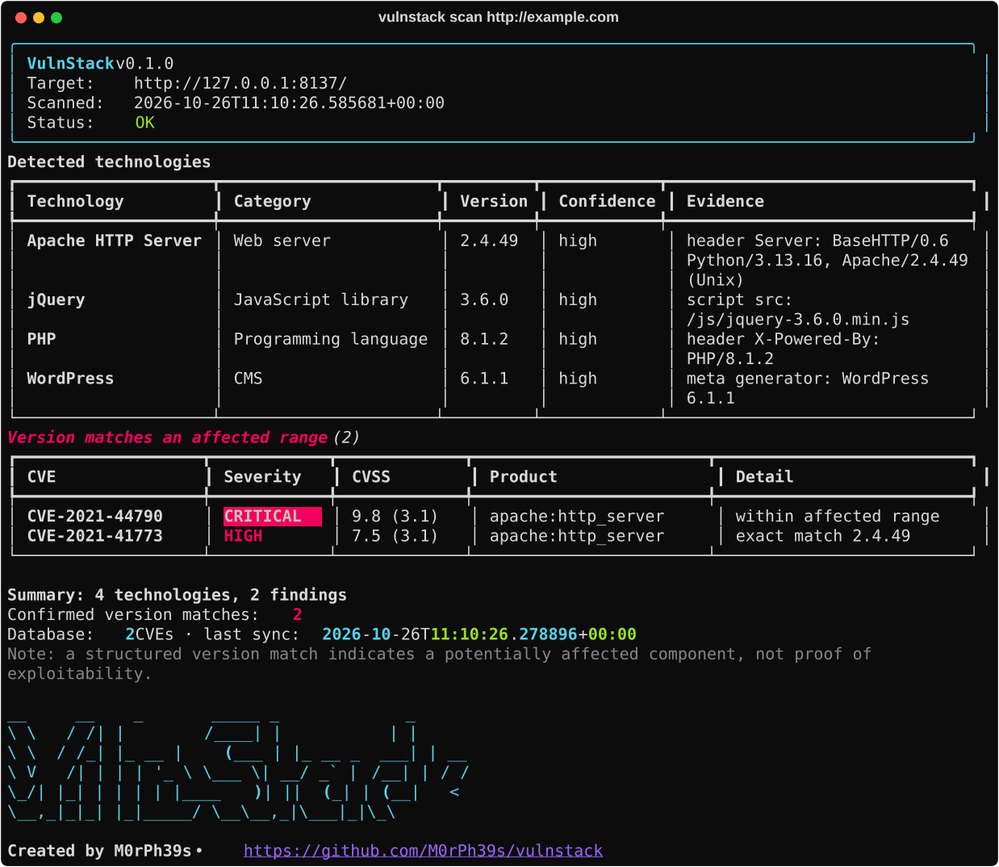

# VulnStack

> Created by **M0rPh39s** · https://github.com/M0rPh39s/vulnstack

**VulnStack** is a non-AI website technology fingerprinting and known-vulnerability
correlation tool for Debian-based Linux. Point it at a URL and it will
fingerprint the technologies in use, extract versions where the evidence
supports it, and automatically correlate those technologies against a local
copy of the NIST National Vulnerability Database (NVD) — comparing detected
versions against structured affected-version ranges.

```
vulnstack scan https://example.com
```

That single command runs the whole workflow: fetch → fingerprint → resolve
products → query the local CVE database → compare versions → classify →
report. You never have to identify technologies by hand or look up individual
CVE IDs.



> **No AI.** VulnStack uses only conventional software techniques — HTTP header
> inspection, HTML parsing, regular expressions, static fingerprints, CPE
> identifiers, indexed SQL queries and explicit version-comparison rules.
> There are no language models, machine learning, embeddings or external AI
> services anywhere in the tool. Results are deterministic for a given input
> and database state.

---

## Features

- **Deterministic fingerprinting** of web servers, languages/runtimes, CMSs,
  frameworks and frontend libraries from headers, HTML, meta-generator tags,
  script/stylesheet URLs and cookies — with evidence, confidence and conflict
  tracking. Versions are never invented.
- **Automatic version-based CVE discovery** driven by a staged, deterministic
  search pipeline (normalization → product/CPE resolution → indexed candidate
  retrieval → version-range comparison → classification → deduplication).
- **Persistent local SQLite CVE database** with a versioned schema, foreign
  keys, indexes and WAL mode. It is a dataset, never executed as code.
- **Incremental + safe full updates** from NVD (with optional CVE List v5
  ingestion), respecting rate limits, retries and date-window boundaries. A
  failed sync never advances the watermark and never loses the previous one.
- **Safe, non-intrusive scanning**: strict SSRF protection, validated
  redirects, IP pinning against DNS rebinding, TLS verification, size/time
  caps. No exploitation, ever.
- **Terminal, JSON and HTML reports** that distinguish confirmed version
  matches from uncertain candidates and never imply exploitability.
- **Pre-built database distribution**: `vulnstack db update` downloads a
  verified, daily-built database from this project's GitHub release instead of
  crawling NVD (direct NVD access remains available).
- **Offline operation** once the database is populated.

## Supported technologies

Fingerprints are plain data in `vulnstack/fingerprints.py`; each maps to a
CPE vendor/product in `vulnstack/product_mapping.py` (a test enforces that
every fingerprint has a mapping and a test case).

| Category | Technologies |
|----------|--------------|
| Web servers / proxies | Apache HTTP Server, Nginx, Microsoft IIS, LiteSpeed, OpenLiteSpeed, Apache Tomcat, Eclipse Jetty, Caddy, Lighttpd, OpenResty, Gunicorn, Tornado, Phusion Passenger, Varnish, Cloudflare¹ |
| Libraries | OpenSSL (from the `Server` header) |
| Languages / runtimes | PHP, ASP.NET, Node.js |
| CMS / platforms | WordPress, Drupal, Joomla, Magento, PrestaShop, TYPO3, Ghost, MediaWiki, Moodle, phpBB, OpenCart, Craft CMS, DokuWiki, Discourse, Strapi |
| Web frameworks | Laravel, Django, Flask, Express, Ruby on Rails, Symfony, CodeIgniter, Next.js, ASP.NET MVC |
| JavaScript / CSS (client-side) | jQuery, jQuery UI, Bootstrap, React, Angular, AngularJS, Vue.js, Lodash, Moment.js, Underscore.js, Handlebars, Axios, TinyMCE, CKEditor, DataTables, Highcharts, Prototype, Modernizr, Backbone.js, Knockout |

¹ Cloudflare is an infrastructure hint only; it has no CVE product mapping and
is reported as "fingerprinted, but not correlated".

Versions are extracted from `Server`/`X-Powered-By`-style headers, meta
generator tags, and versioned asset URLs (`lib-1.2.3.min.js`, CDN paths such as
`/ajax/libs/lib/1.2.3/` and `lib@1.2.3/`). Most cookie-, HTML- and
framework-based signatures identify the product but **cannot** reveal a
version, so those are reported with version "unknown" and correlated as
`VERSION_UNKNOWN` (verify), never as a confirmed match.

**Not supported** (by design or not yet): active probing (no requests for
`/wp-login.php`, `/readme.html`, favicon hashes, etc.); executing JavaScript;
crawling beyond the one requested page and its redirects; SaaS platforms with
no meaningful CPE (Shopify, Wix, Squarespace); WAF/CDN vendors other than
Cloudflare and Varnish; Spring, Struts and other JVM frameworks that leave no
reliable passive HTTP signature; Concrete CMS (its CPE vendor changed over
time, so it is left out rather than guessed); and plugin/theme-level detection.

## Supported platforms

Debian-based Linux (Debian, Ubuntu, etc.) with Python **3.11+**. It also runs
on other Linux distributions and macOS; paths follow the XDG base-directory
spec. Root privileges are **not** required.

## Installation

### Debian/Ubuntu prerequisites

```bash
sudo apt update
sudo apt install -y python3 python3-venv python3-pip
```

### Virtual environment (recommended)

```bash
python3 -m venv .venv
source .venv/bin/activate
pip install -e .
vulnstack --help
```

### pipx (isolated global install)

```bash
sudo apt install -y pipx
pipx install .
vulnstack --help
```

> VulnStack is **not** available via `apt`. Install it with pip/pipx as above.

## Quick start

```bash
# 1. Populate the local vulnerability database. By default this downloads the
#    pre-built database published by this project (fast; no NVD crawl).
vulnstack db update            # delta if you are close, full download otherwise
vulnstack db update --full     # force a complete re-download
vulnstack db update --source nvd   # or query NVD yourself (slow; see below)

# 2. Scan a site — technology detection + automatic CVE correlation.
vulnstack scan https://example.com

# 3. Inspect the database.
vulnstack db status
vulnstack db stats
```

## CLI commands

```
vulnstack --help
vulnstack --version

vulnstack scan <url> [--no-cve] [--format terminal|json|html]
                     [--output FILE] [--timeout SECONDS]
                     [--show-unmatched] [--allow-private] [--verbose]

vulnstack technologies <url> [--format ...] [--output FILE] [--timeout ...]

vulnstack cve search "<term>" [--limit N]
vulnstack cve show CVE-YYYY-NNNNN

vulnstack db update [--full] [--source repo|nvd|cvelist] [--bootstrap-days N]
                    [--cvelist-path PATH]
vulnstack db publish --out DIR [--delta-days N]
vulnstack db status
vulnstack db stats
vulnstack db clear [--yes]

vulnstack config show
vulnstack cache clear
```

### Exit codes

| Code | Meaning |
|------|---------|
| `0`  | Operation completed successfully. **A scan that finds vulnerabilities still exits `0`** — findings are a result, not an error. |
| `1`  | Runtime error (invalid/blocked target, network failure, provider error, database problem). |
| `2`  | Invalid command-line usage, including a command group with no subcommand (`vulnstack db`). |

Stack traces are shown only with `--verbose`; otherwise a concise error message
is printed. Secrets are never printed.

## Example scans

```bash
# Terminal report (default)
vulnstack scan https://example.com

# Machine-readable JSON to a file
vulnstack scan https://example.com --format json --output report.json

# Self-contained HTML report
vulnstack scan https://example.com --format html --output report.html

# Fingerprint only, no CVE correlation
vulnstack scan https://example.com --no-cve

# Also list CVEs whose version did NOT match
vulnstack scan https://example.com --show-unmatched
```

## Database initialization & updates

The database lives at `~/.local/share/vulnstack/vulnstack.db` by default
(override with `VULNSTACK_DATABASE` or config).

- **`vulnstack db update`** (default source `repo`) — downloads the database
  this project publishes to the `db-latest` release of
  `github.com/M0rPh39s/vulnstack` (see *Published database* below). It never
  contacts NVD.
- **`vulnstack db update --source nvd`** — incremental, directly from NVD. Fetches only records modified since
  the last successful synchronization (with a small overlap so boundary
  records are not skipped). On the very first run with no prior sync it fetches
  a recent window (`--bootstrap-days`, default 30) and tells you so; run a full
  sync for the complete dataset. The window is whole days, and a busy day is
  large: one day of NVD modifications was ~3,900 records when measured.
- **`vulnstack db update --full`** — with the default source, re-downloads the
  whole published database. With `--source nvd`, a full synchronization/rebuild. This can
  download the entire NVD corpus (hundreds of thousands of records): expect
  significant **network, time and disk** usage. The rebuild is written to a
  temporary database, validated, and only then atomically installed — a failed
  full sync never destroys your existing database.
- **`--source`** selects the data source: `repo` (default), `nvd`, or `cvelist`
  (see below). Set `default_source` in the config file to change the default,
  e.g. `default_source = "nvd"`.

### Published database

The project's scheduled workflow (`.github/workflows/update-db.yml`) builds the
database from NVD once a day and attaches three files to the `db-latest`
release: `manifest.json`, a full database, and a delta of the last
7 days of changes. `vulnstack db update` fetches the manifest and then:

| Local state | Action |
|-------------|--------|
| Already at the published build | nothing (only the small manifest is downloaded) |
| Behind by less than the delta window | downloads and applies the delta |
| Empty, older, or `--full` | downloads the full database and installs it |

Safeguards: the download location is a fixed constant (not configurable), only
HTTPS to GitHub hosts is followed and each redirect hop is checked before it is
requested; every file must match the exact size and SHA-256 in the manifest and
is capped in compressed and decompressed size; a full database is validated
(schema version, SQLite integrity check, record count) in a temporary file and
only then atomically swapped in; a delta is parsed completely before any record
is applied. A failed pull leaves your existing database untouched.

Things to know:

- The data is **as fresh as the last scheduled build** (daily), not live. Use
  `--source nvd` when you need records from the last few hours.
- A full install **replaces** the local database file, including records you
  ingested from another source such as `cvelist`.
- The checksum comes from the same release as the files, so it protects against
  corruption and truncation, not against someone who can modify the release.
  You are trusting this repository's release, as with any binary download.
- If nothing has been published yet, or the release is unreachable, `db update`
  exits `1` and suggests `--source nvd`.
- Data is from the NVD. This product uses the NVD API but is not endorsed or
  certified by the NVD.

### Publishing the database (maintainers)

1. Add a repository secret `NVD_API_KEY`.
2. Seed the first release. Either run the *Update vulnerability database*
   workflow manually with **full** ticked, or — if a full NVD crawl would exceed
   GitHub's 6-hour job limit — do it locally and upload by hand:
   ```bash
   export NVD_API_KEY=...
   vulnstack db update --source nvd --full
   vulnstack db publish --out dist
   gh release create db-latest --latest=false --title "Vulnerability database" --notes "Built from NVD"
   gh release upload db-latest dist/vulnstack-db-full.sqlite.gz dist/vulnstack-db-delta.jsonl.gz
   gh release upload db-latest dist/manifest.json     # always last
   ```
3. After that the daily workflow starts from the published database, fetches
   what changed from NVD, and republishes. `db publish` refuses to publish an
   empty database or one without a successful sync.

The workflow itself has not been run end to end in CI; the publish/pull logic is
covered by the test suite and was exercised against real NVD data locally.

NVD rate limits are respected automatically (5 requests / 30 s without a key,
50 with one). NVD serves large pages slowly, so VulnStack requests 200 records
per page with a 60 s read timeout (2000-record pages timed out in testing);
expect a one-day window to take a few minutes without a key. Set an API key to
go faster:

```bash
export NVD_API_KEY=xxxxxxxx-xxxx-xxxx-xxxx-xxxxxxxxxxxx
vulnstack db update
```

The key is read only from the environment, sent only in the request header to
NVD, and never written to logs, reports or the config file.

## Database status & statistics

```bash
vulnstack db status   # location, schema version, counts, sources, last sync, size
vulnstack db stats    # CVE counts by severity and by year
vulnstack db clear    # delete all vulnerability data (asks for confirmation)
```

In `db status`, **Last successful sync** is the wall-clock time of the last
sync that succeeded (a failed attempt never overwrites it; the failure is shown
under *Last status*/*Last error*), and **Newest record synced** is the incremental
watermark. Scan staleness ("possibly outdated" after 14 days) is judged from the
former.

`db clear` removes vulnerability records **and** cached sync metadata but keeps
the schema. It never touches your configuration or cache files, and is never
part of a normal update.

## Technology detection — limitations

- A response header (e.g. `Server`) reflects what the *response* reported.
  Reverse proxies, CDNs and caches can produce misleading or masked headers, so
  a header is treated as evidence, not proof of the origin software.
- A detected JavaScript library (jQuery, React, …) is reported as a client-side
  library only; it is never taken as evidence of a backend framework.
- When a version cannot be determined it is reported as unknown — VulnStack does
  not invent version numbers.
- Conflicting version signals are preserved and reported, not silently merged.
- VulnStack performs the minimum requests needed and never executes downloaded
  JavaScript or crawls the site.

## Version matching behaviour

Detected versions are compared against structured affected-version ranges
(inclusive/exclusive bounds, open-ended ranges, exact versions, multiple ranges
and products). Comparison is **not** lexical and does not assume semantic
versioning: it uses `packaging.version` where appropriate and a safe
component-wise fallback otherwise. When a comparison cannot be made safely it is
reported as **uncertain**, never as a match.

Each result is given an explicit classification:

| Classification | Meaning |
|----------------|---------|
| `MATCHED_AFFECTED_RANGE` | Detected version falls within a structured affected range (or exact match). |
| `VERSION_NOT_MATCHED` | Detected version is outside all affected ranges. |
| `VERSION_UNKNOWN` | Product matched but the version is unknown — verify. |
| `PRODUCT_MAPPING_AMBIGUOUS` | More than one product could match — verify. |
| `AFFECTED_RANGE_UNAVAILABLE` | Product matched but the record has no version range — verify. |
| `SOURCE_DATA_INCOMPLETE` | Version comparison could not be made safely. |

> A structured version match indicates a **potentially affected component**, not
> proof that it is reachable or exploitable. VulnStack is a correlation tool, not
> an exploitation framework.

## Data sources

- **NVD** (primary) — the official [CVE API 2.0](https://nvd.nist.gov/developers/vulnerabilities).
- **CVE List v5** (optional) — official [CVEProject/cvelistV5](https://github.com/CVEProject/cvelistV5)
  records ingested from a local path:
  ```bash
  vulnstack db update --source cvelist --cvelist-path /path/to/cvelistV5
  # or: export VULNSTACK_CVELIST_PATH=/path/to/cvelistV5
  ```
  A local tree is always read in full (the `--bootstrap-days` window does not
  apply). Product matching uses the record's own `cpes` when present; for
  records that carry none, the vendor/product *names* are lower-cased into a
  best-effort CPE guess that often will not match, so such CVEs may be missed.
  Unreadable files and JSON that is not a CVE record are skipped with a warning.

Each record stores its originating source. Providers are abstracted so new
trusted sources can be added without changing the database or search layers.

## Offline operation

After the database is initialized, fingerprinting and local CVE correlation work
without internet access (subject to the target being reachable). If the network
is unavailable but the database exists, the scan continues using local records.

## Report generation

- **Terminal** — a concise rich report grouping findings by classification, with
  evidence, severities and database freshness.
- **JSON** — a complete, valid, machine-readable document (technologies,
  evidence, findings, classifications, references, database metadata, summary).
  Contains no secrets.
- **HTML** — a self-contained page (inline CSS, no remote resources/JS). All
  untrusted website-derived text is HTML-escaped.

## Configuration

Configuration lives at `~/.config/vulnstack/config.toml` (override with
`VULNSTACK_CONFIG`). Precedence, lowest to highest:

```
built-in defaults  <  config file  <  environment variables  <  CLI options
```

Supported keys include `timeout`, `max_redirects`, `max_response_bytes`,
`user_agent`, `allow_private_targets`, `default_format`, `output_dir`,
`database_path`, `cache_dir`, `cache_ttl_seconds`, `default_source`,
`logging_level`. Example `config.toml`:

```toml
timeout = 20
default_format = "terminal"
cache_ttl_seconds = 3600
```

Environment overrides: `VULNSTACK_TIMEOUT`, `VULNSTACK_FORMAT`,
`VULNSTACK_OUTPUT_DIR`, `VULNSTACK_DATABASE`, `VULNSTACK_CACHE_DIR`,
`VULNSTACK_LOG_LEVEL`, `VULNSTACK_ALLOW_PRIVATE`. `vulnstack config show`
displays effective values and reports whether `NVD_API_KEY` is set (redacted).

## Cache

A small on-disk cache module (`~/.cache/vulnstack/`, TTL-based) exists and
`vulnstack cache clear` empties it, but **the scan workflow does not currently
read or write it**: every scan fetches the target fresh. It is distinct from the
CVE database and never stores secrets.

## Security considerations

VulnStack scans conservatively and non-intrusively:

- Only `http`/`https` URLs are accepted; malformed URLs and other schemes are
  rejected.
- Hostnames are resolved and **every** resolved IP is validated before
  connecting. Loopback, private, link-local, unspecified, multicast and other
  reserved ranges are blocked by default (IPv4 and IPv6, including IPv4-mapped
  IPv6).
- The connection is pinned to a validated IP for the duration of the request
  to defeat DNS rebinding and validation-to-connection races. If a host has
  several addresses, **all** must be public (one blocked address refuses the
  host), IPv4 is tried first, and if a connection cannot be established
  (e.g. an IPv6 address on a host with no IPv6 route) the next already-validated
  address is tried. Only connection failures fall through: TLS, HTTP and
  post-connect timeout errors are reported immediately, and an address outside
  the validated set is never used. Every redirect
  destination is re-validated with the same rules; redirects cannot escape the
  IP policy and are bounded.
- TLS certificate verification is always on and never disabled automatically.
- Connection/read timeouts are always set; response size is capped and read
  incrementally; oversized bodies are truncated safely.
- Cookies/credentials are never persisted or forwarded; ambient HTTP proxy
  environment variables are ignored for scan targets.
- No exploitation, brute force, credential testing or destructive behaviour.
- `--allow-private` exists for local testing and explicitly opts out of the
  private-address block; use it only against hosts you control.

## Known limitations

- Fingerprinting relies on public HTTP evidence; heavily customized or
  proxied sites may expose little. Headers can be spoofed or stripped.
- CVE correlation is only as complete and current as your local database — keep
  it updated. Records with no structured affected-version data are surfaced as
  "verify", not confirmed.
- A full NVD synchronization is large and slow without an API key.
- Fingerprinting reports what the response *claims*; a version string is never
  verified, and distro back-ported fixes (e.g. Debian's patched `Apache/2.4.x`)
  are not accounted for, so a "match" can be a false positive.
- VulnStack reports *potential* exposure, never confirmed exploitability.

## Troubleshooting

- **"Local vulnerability database is not initialized"** — run `vulnstack db update`.
- **"target rejected" / blocked address** — the host resolves to a
  private/reserved IP; this is intentional SSRF protection.
- **Slow updates / HTTP 429** — you are being rate-limited; set `NVD_API_KEY`.
- **TLS verification failed** — the target's certificate is invalid; VulnStack
  does not disable verification. Fix the target or scan a valid endpoint.
- Use `--verbose` for diagnostic logging (to stderr) and full tracebacks.

## Development setup

```bash
python3 -m venv .venv
source .venv/bin/activate
pip install -e ".[dev]"
```

Project layout:

```
.github/workflows/    CI (pytest on Python 3.11, 3.12, 3.13)
vulnstack/            cli, config, http_client, fingerprinting, scanner, ...
vulnstack/cve/        models, database, migrations, providers, nvd, cve_json,
                      updater, search
vulnstack/reports/    terminal, json_report, html_report
tests/                pytest suite (no live network required)
```

## Testing

```bash
pip install -e ".[dev]"
pytest
```

The suite (393 tests, ~95% line coverage) covers CLI behaviour, exit codes and
error paths, fingerprinting (one test per catalogue signature plus
false-positive regressions), product mapping, version comparison, the database
(migrations, upserts, transactions, foreign keys, injection-safety), the update
engine (incremental, full, mid-stream failure/recovery, watermark handling,
dedup, date windows), NVD parsing/pagination/retry, the CVE List v5 provider,
the published-database publish/pull flow (round trips, deltas, tampering, hostile redirects),
the search pipeline, SSRF/redirect/size/multi-address security, report
validity/escaping, the end-to-end scan workflow, and search performance (index
usage, batching). All HTTP and provider responses are mocked, and an autouse
fixture makes any attempt to open a real socket fail the test, so no live
internet is required.

```bash
pytest --cov=vulnstack --cov-report=term-missing
```

### Continuous integration

`.github/workflows/ci.yml` installs the package (`pip install -e ".[dev]"`) and
runs `pytest` on every push and pull request across Python 3.11, 3.12 and 3.13.

## License

MIT — see [LICENSE](LICENSE).
